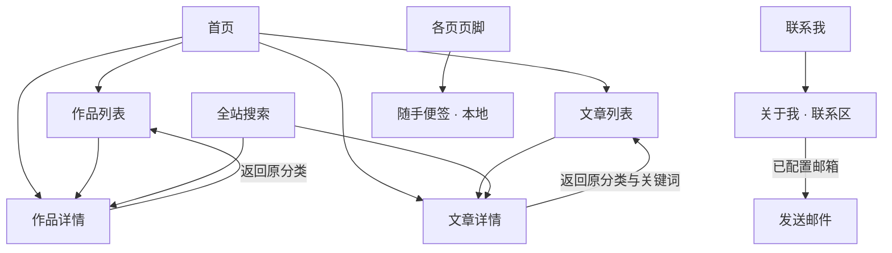

# 页面与跳转规则（0.12.0）

## 本轮交互补充

- 站内作品/文章详情入口使用 →；新标签外链使用 ↗。
- 首页作品文字进入详情，截图独立打开大图（⤢），避免两种点击混淆；详情主图与正文插图同样支持大图。
- 有多个带标题小节的作品自动生成目录。小节采用原生 hash；列表来源随小节历史保留，返回列表仍恢复筛选与滚动高度。
- ZL AI LAB 为展示网站，GitHub 账号仅放在关于页联系区。账号链接不代表私信通道，项目交流指向对应公开仓库中已开放的问题区。

## 页面结构

## 统一规则

| 入口 | 去向与行为 |
| --- | --- |
| 顶部导航、站点标志 | 打开对应栏目完整列表或首页，不继承上次筛选 |
| 首页作品、作品列表标题、搜索作品结果 | 同一个 `project.html?id=作品ID` 详情页 |
| 首页文章、文章列表、相关文章、搜索文章结果 | 同一个 `article.html?id=文章ID` 详情页 |
| 详情中的面包屑和“返回列表” | 返回对应栏目；从列表进入时保留分类、文章搜索词，并恢复该列表的滚动高度 |
| 浏览器后退、前进 | 使用浏览器原生历史，不拦截成跳首页或其他栏目 |
| 联系我 | 固定进入 `about.html#contact`；邮箱未填写时显示状态，配置有效邮箱后显示明确的发送邮件按钮 |
| 页脚“随手便签（本地）” | 进入 `guestbook.html`；主导航不再包含本地便签，数据仍仅存当前浏览器 |
| 源码仓库 | 外部地址在新标签页打开并标明；站内链接使用当前标签页 |

## 地址与兼容

- 作品列表：`projects.html`；带分类示例：`projects.html?category=本地工具`。
- 作品详情：`project.html?id=recallai`；列表上下文通过已知的 `category` 参数携带。
- 文章列表：`articles.html`；筛选地址支持 `category` 和 `q`。
- 文章详情：`article.html?id=hello-world`；从列表进入和继续阅读时携带原列表上下文。
- 分类只接受本站数据中存在的分类；关键词最多 100 字符。返回地址由固定栏目生成，不接收任意返回 URL。
- 旧地址 `projects.html#recallai` 等已知项目锚点会替换为新详情地址；只替换这一条过渡历史，避免后退反复跳转。
- `#main`、未知项目锚点不会触发详情跳转。缺少或错误的详情 ID 显示不存在状态，不自动展示第一篇内容。
- 所有页面继续支持直接以 `file://` 打开。

共享 URL 规则位于 `assets/navigation.js`。列表与详情通过自己的脚本维护内容，不引入客户端路由框架。

## 滚动位置

- 只在作品／文章列表的详情入口记录位置，保存在当前标签页的 `sessionStorage` 中，并附着到对应详情的历史记录。
- 显式返回与面包屑恢复原列表；文章继续阅读传递同一来源位置。直接从首页或全站搜索进入详情，不套用无关列表的旧位置。
- 顶部导航仍是完整栏目的新入口。浏览器前进／后退保留原生行为；不会把 `history.scrollRestoration` 全局改成手动模式。
- 位置恢复等待列表、字体布局完成，并限制到当前页面可滚动范围；显式锚点优先。存储不可用时降级为正常链接，既有分类和关键词规则继续生效。

主导航固定为首页、作品、文章、关于；搜索和联系仍为公共入口。当前检查记录在 `research/maintenance-pass/`，历史导航与视觉记录保留原样。
